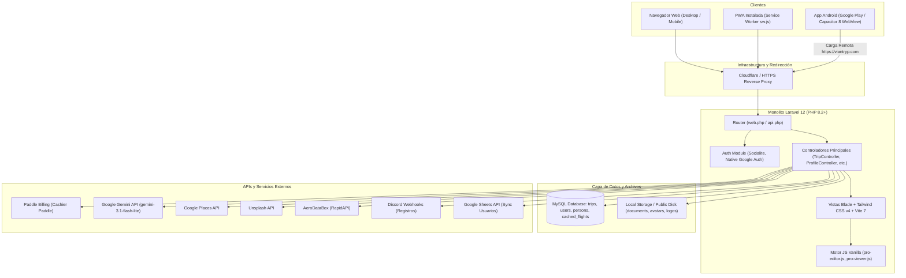

# AUDITORÍA INTEGRAL VIANTRYP — ETAPA 1: ARQUITECTURA E INVENTARIO FUNCIONAL

**Fecha de Ejecución:** Octubre 2026  
**Entorno Auditado:** Código fuente local (PHP 8.2+, Laravel 12.0, Capacitor 8, Android, PWA)  
**Modalidad:** Solo Lectura (Inspección estricta de código, configuraciones y dependencias)

---

## 1. RESUMEN EJECUTIVO DE ARQUITECTURA

Viantryp está construida sobre una arquitectura monolítica moderna basada en **Laravel 12.0** que sirve tanto la plataforma Web de escritorio como la PWA y la aplicación móvil Android distribuida en Google Play.

### Hallazgo Arquitectónico Central sobre Android / Capacitor
La aplicación Android (`com.viantryp.app`) **no es una aplicación nativa ni empaqueta un frontend SPA local**. La configuración en `capacitor.config.json` define explícitamente:
```json
"server": {
    "url": "https://viantryp.com",
    "cleartext": false,
    "allowNavigation": ["viantryp.com", "*.viantryp.com", ...]
}
```
Esto confirma que la app de Google Play funciona como un **Capacitor WebView remoto** sobre el sitio web en producción. Cualquier despliegue al servidor web afecta instantáneamente tanto a los usuarios web como a los usuarios que abren la app de Google Play.



---

## 2. MAPEO DETALLADO DE TECNOLOGÍAS Y COMPONENTES

| Capa | Tecnología / Herramienta | Versión / Detalle |
| :--- | :--- | :--- |
| **Backend Framework** | Laravel Framework | `^12.0` (PHP `^8.2`) |
| **Gestor de Paquetes PHP** | Composer | PSR-4 (`App\`), Helper `AirportHelper.php` |
| **Base de Datos** | MySQL | Motor relacional (`viantryp`), soporte de campos JSON (`pro_state`, `days_dates`, `custom_statuses`) |
| **Monitoreo & Colas** | Laravel Telescope, Horizon, Pail | Telescope `^5.15`, Horizon `^5.38` |
| **Frontend Rendering** | Laravel Blade Views | Server-side rendered views con Tailwind CSS v4 (`^4.0.0`) y Vite 7 (`^7.0.4`) |
| **Lógica Interactiva Itinerarios** | JavaScript Vanilla Modular | `pro-editor.js` (248 KB), `pro-viewer.js` (189 KB), Quill.js `^1.3.7` |
| **Pasarela de Pago** | Paddle | `laravel/cashier-paddle`, integración Paddle.js y API REST |
| **PWA** | Web App Manifest + Service Worker | `manifest.json`, `sw.js` (Estrategia Network-First, caché estática `viantryp-v6`) |
| **Wrapper Móvil Android** | Capacitor | `@capacitor/android` `^8.5.2`, `@capacitor/core` `^8.5.2`, `@capacitor/app` `^8.1.1` |
| **Plugins Capacitor** | Status Bar, Splash Screen, Google Auth | `@codetrix-studio/capacitor-google-auth` `^3.4.0-rc.4` |
| **IA / Copilot** | Google Gemini API | `TripAiService.php` (`gemini-3.1-flash-lite` con fallback a mock local) |
| **APIs de Viajes** | Google Places & AeroDataBox | `GooglePlacesController.php`, `FlightLookupController.php` (RapidAPI) |
| **Imágenes & Media** | Unsplash API & DomPDF | Búsqueda Unsplash integrada, `barryvdh/laravel-dompdf` `^3.1` |

---

## 3. INVENTARIO FUNCIONAL: ESTADO DE IMPLEMENTACIÓN Y VERIFICACIÓN

| Módulo / Funcionalidad | Estado Real | Componentes Afectados | Descripción y Observaciones Técnicas |
| :--- | :--- | :--- | :--- |
| **Landing Page Pública** | Implementada | `landing.blade.php`, `routes/web.php` | Landing con secciones de producto, testimonios, FAQs y tabla de precios. Redirige a `/trips` si hay sesión activa. |
| **Autenticación (Email/Password)** | Implementada con riesgo | `LoginController`, `RegisterController`, `User.php` | Registro funcional con RateLimiting. **Riesgo:** validación `email:rfc,dns` en el formulario de Login puede bloquear usuarios válidos. No hay verificación de email requerida. |
| **Autenticación Google (Web)** | Implementada | `GoogleAuthController`, `Socialite` | Flujo estándar OAuth 2.0 y soporte de Google Identity Services (GSI). Crea usuario básico y envía bienvenida. |
| **Autenticación Google (Android)** | Implementada y validada | `GoogleAuthController::handleNativeGoogleAuth` | Valida criptográficamente el token con `Google_Client->verifyIdToken($idToken)`. Asigna cookie y sesión de app móvil. |
| **Recuperación de Contraseña** | Implementada | `ForgotPasswordController`, `CustomResetPassword` | Flujo estándar con token firmado por email (`password.reset`). |
| **Editor de Itinerarios Pro** | Implementada | `TripController::createPro`, `pro-editor.blade.php`, `pro-editor.js` | Editor interactivo en JavaScript de gran tamaño (248KB). Maneja destinos, vuelos, hoteles, transportes, notas, costos y fotos Unsplash. Guarda estado en `trips.pro_state` (JSON). |
| **Persistencia de Itinerarios** | Implementada | `TripController::saveProState`, `storePro` | Valida límites de plan (fotos Unsplash, GIFs, adjuntos) y guarda en DB relacional. |
| **Visor Público de Itinerarios** | Implementada | `TripController::share`, `pro-share.blade.php`, `pro-viewer.js` | Acceso sin autenticación mediante token público único (`trips/share/{token}`). Cuenta vistas del viaje. |
| **Adjuntos y Documentos** | Implementada con fallo grave | `TripDocumentController`, `TripController::uploadAttachment` | Sube PDFs/imágenes. **Fallo:** Los archivos se guardan en el disco público (`Storage::disk('public')->put('documents/...')`), omitiendo la autorización del controlador. |
| **Gestión de Personas (Clientes/Agentes)** | Rota / Brecha de Seguridad | `PersonController`, `Person.php` | **Crítico:** No existe columna `user_id` ni aislamiento multi-tenant. Cualquier usuario puede ver, modificar o borrar todos los clientes de la plataforma. |
| **Gestión de Aerolíneas** | Insegura | `AirlineController`, `Airline.php` | CRUD expuesto a cualquier usuario logueado sin rol de administrador. |
| **Suscripciones y Planes (Paddle)** | Roto / Vulnerabilidad P0 | `ProfileController::syncPaddlePlan`, `config/plans.php` | **Crítico:** El endpoint `/profile/plan/paddle-sync` actualiza el plan del usuario sin validar transacción, firma ni webhook de Paddle. Permite escalada de privilegios gratuita. |
| **Prueba Gratuita (Trial)** | Implementada | `User::isTrialActive`, `trial_ends_at` | Otorga límites de "Viajero Pro" temporalmente mientras `trial_ends_at` esté vigente en el futuro. |
| **Asistente IA (Tryp IA)** | Implementada con API Gemini | `TripAiController`, `TripAiService` | Conecta con `gemini-3.1-flash-lite`. Limita a 5 consultas en plan Básico; ilimitado en planes superiores. |
| **Integraciones Externas (Discord/Sheets)** | Implementada | `DiscordService`, `GoogleSheetService` | Notifica registros a Discord y añade filas en Google Sheets. Transmite PII (email, nombre) a servicios externos. |
| **PWA (Instalación y Offline)** | Parcialmente Implementada | `manifest.json`, `sw.js` | Manifiesto completo y funcional. El service worker tiene caché de estáticos pero no almacena datos de itinerarios offline. |
| **Android Capacitor** | Publicada en Google Play | `android/`, `capacitor.config.json` | Versión 1.0.10 (build 22) en tienda. Carga URL remota. **Fallo:** Credenciales de firma y keystore expuestas en el repositorio. |
| **Compatibilidad iOS** | Inexistente en código | `package.json`, raíz | No está instalado `@capacitor/ios` ni existe la carpeta nativa `/ios`. |

---

## 4. HALLAZGOS CRÍTICOS IDENTIFICADOS EN LA ETAPA 1

### [CRÍTICO - P0] Escalada Gratuita de Planes en `ProfileController::syncPaddlePlan`
- **Ubicación:** `app/Http/Controllers/ProfileController.php` (Líneas 285-359).
- **Evidencia:** El método toma `price_id` del payload JSON de la petición del cliente y, si coincide con alguno de los IDs públicos configurados en `config/plans.php`, actualiza inmediatamente la base de datos:
  ```php
  $user->update(['plan' => $matchedPlan, 'trial_ends_at' => null]);
  ```
- **Impacto:** Cualquier usuario registrado puede ejecutar un `curl` o llamada Fetch con el `price_id` del plan corporativo o avanzado y auto-activarse la suscripción de por vida sin haber pagado un solo centavo.

### [CRÍTICO - P0] Fuga Masiva de Datos de Clientes y Falta de Aislamiento en `PersonController`
- **Ubicación:** `app/Http/Controllers/PersonController.php` (Líneas 13-17, 47-51, 84-90) y `app/Models/Person.php`.
- **Evidencia:**
  ```php
  public function index() {
      $persons = Person::all();
      return view('persons.index', compact('persons'));
  }
  ```
  La tabla `persons` carece de campo `user_id`.
- **Impacto:** Cualquier agencia o usuario registrado puede acceder a `/persons` y extraer todos los nombres, correos y teléfonos de los clientes cargados por agencias competidoras, o borrarlos masivamente. Violación directa de GDPR y confidencialidad comercial.

### [ALTO - P1] Fuga de Documentos Privados en Almacenamiento Público
- **Ubicación:** `app/Http/Controllers/TripController.php` (Líneas 824-827).
- **Evidencia:**
  ```php
  $path = 'documents/' . $filename;
  $stored = Storage::disk('public')->put($path, $file->get());
  ```
- **Impacto:** Aunque `TripDocumentController::download` tiene verificación de permisos, los archivos se guardan en el disco `public` (enlace simbólico web `public/storage/documents/...`). El servidor web (Nginx/Apache) los sirve directamente sin pasar por PHP si se conoce o enumera el nombre del archivo.

### [ALTO - P1] Credenciales de Firma y Keystore Expuestas en el Repositorio
- **Ubicación:** `android/app/build.gradle` (Líneas 19-26) y raíz `/viantryp-release-official.keystore` y `/voyager_key.pem`.
- **Evidencia:**
  ```groovy
  signingConfigs {
      release {
          storeFile file("${rootDir}/../viantryp-release-official.keystore")
          storePassword 'viantryp2026'
          keyAlias 'viantryp'
          keyPassword 'viantryp2026'
      }
  }
  ```
- **Impacto:** El archivo keystore oficial para publicar en Google Play y sus contraseñas en texto plano residen en el repositorio local. Si este repositorio se replica o comparte, terceros pueden firmar versiones maliciosas con la identidad oficial de Viantryp.

### [MEDIO - P2] Desconexión de Deep Linking en Android (AssetLinks Mismatch)
- **Ubicación:** `routes/web.php` (Línea 91) vs `android/app/build.gradle` (Línea 7).
- **Evidencia:** En `routes/web.php` `.well-known/assetlinks.json` declara:
  `'package_name' => 'com.viantryp.www.twa'`
  Mientras que la app publicada en Google Play usa:
  `applicationId "com.viantryp.app"`
- **Impacto:** Los enlaces compartidos de viajes abiertos desde dispositivos Android no abren la aplicación instalada automáticamente.

### [MEDIO - P2] Validación DNS Bloqueante en Formulario de Login
- **Ubicación:** `app/Http/Controllers/Auth/LoginController.php` (Línea 28).
- **Evidencia:**
  ```php
  'email' => 'required|email:rfc,dns|max:255'
  ```
- **Impacto:** Comprobar registros MX por DNS al momento del Login es propenso a falsos positivos y caídas de servicio si el DNS tiene latencia o si el dominio del usuario tiene problemas temporales de resolución.

---

## 5. CONCLUSIONES DE LA ETAPA 1

La arquitectura base de Viantryp es moderna y ágil gracias a Laravel 12 y Tailwind v4, y el editor de itinerarios `pro-editor.js` cuenta con una funcionalidad interactiva rica. Sin embargo, existen **dos vulnerabilidades de severidad P0 (Escalada de pago no verificado y fuga multi-tenant de clientes)** que deben ser corregidas antes de cualquier apertura comercial o campaña publicitaria web.

