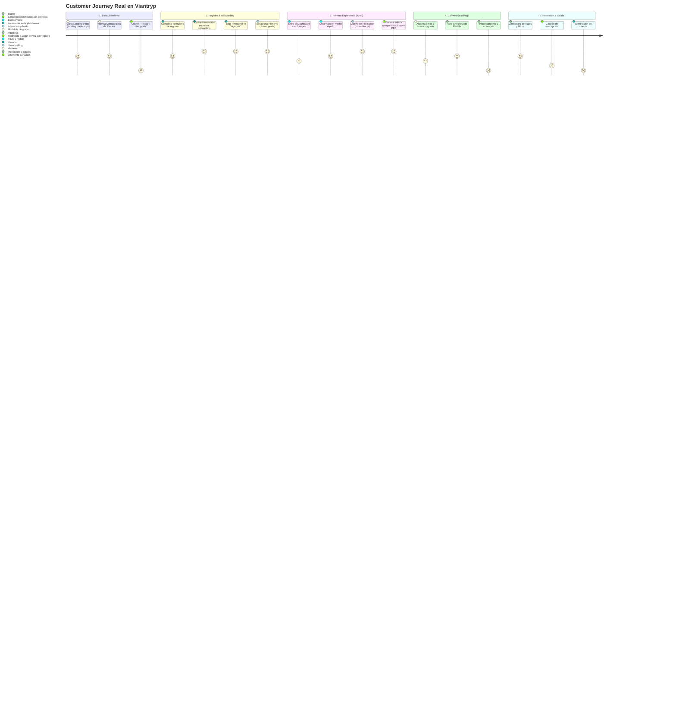

# AUDITORÍA INTEGRAL VIANTRYP — ETAPA 2: CUSTOMER JOURNEY, PAGOS Y COMUNICACIONES

**Fecha de Ejecución:** Octubre 2026  
**Entorno Auditado:** Código fuente local (PHP 8.2+, Laravel 12.0, Blade, Paddle Cashier, Sistema de Notificaciones)  
**Modalidad:** Solo Lectura (Inspección exhaustiva de controladores, vistas, listeners, flujos de usuario y pasarela de pago)

---

## 1. RESUMEN EJECUTIVO DE LA ETAPA 2

Esta segunda etapa ha auditado el ciclo de vida completo del cliente (Customer Journey de punta a punta: Adquisición $\to$ Registro $\to$ Onboarding $\to$ Activación del 1er itinerario $\to$ Conversión a Pago $\to$ Retención y Salida), la pasarela de pagos Paddle y las comunicaciones transaccionales.

### Hallazgos Críticos Más Destacados:
1. **Fallo en el Modelo de Negocio (Pro Gratuito Perpetuo):** En el onboarding (`ProfileController::chooseInitialPlan`), a cada nuevo usuario se le asigna `plan = 'avanzado'` y `trial_ends_at = +30 días`. Sin embargo, **no existe ningún cron, comando ni middleware que degrade al usuario a 'básico' cuando expira el trial**. Una vez registrado, el usuario disfruta de todas las funciones del Plan Viajero Pro de por vida sin pagar.
2. **Riesgo Inminente de Expulsión en Google Play:** La app de Android (que carga la web remotamente) utiliza Paddle.js (tarjeta/PayPal) dentro del WebView para cobrar suscripciones, violando directamente la política obligatoria de Google Play Billing para bienes digitales.
3. **Ausencia Total de Eliminación de Cuenta:** La plataforma carece de ruta, controlador o interfaz para borrar la cuenta de usuario. Esto incumple los requisitos obligatorios de Google Play, las directrices de Apple App Store (Guideline 5.1.1) y el derecho de supresión del GDPR (Art. 17).
4. **Fricción Grave en Landing:** El botón "Probar 7 días gratis" en la landing redirige a una ruta protegida por el middleware `auth` (`/planes-redirect`), forzando a los nuevos visitantes al formulario de **Login** en lugar del formulario de **Registro**.

---

## 2. CUSTOMER JOURNEY PASO A PASO: RECONSTRUCCIÓN DEL FLUJO REAL

### Detalle de cada Recorrido:

### A. Visitante que Descubre Viantryp
- **Pantalla:** `landing.blade.php` (~7,000 líneas).
- **Fortalezas:** Propuesta de valor visualmente atractiva, diseño moderno en Syne/Inter, secciones de testimonios, preguntas frecuentes y tabla de precios interactiva mensual/anual con toggle del 20% de descuento.
- **Puntos Críticos de Fricción:**
  1. **Redirección errónea de CTA:** El botón "Probar 7 días gratis" en los planes Viajero Pro y Negocios enlaza a `{{ route('plans.redirect') }}`. Dicha ruta tiene el middleware `auth`, lo que provoca que un visitante sin cuenta sea enviado a `/login` en vez de `/register`.
  2. **Incoherencia en días de prueba:** La landing promete **7 días de prueba gratis** (*"Facturado mensualmente · 7 días de prueba gratis"*), pero al registrarse, el modal de bienvenida anuncia **1 mes gratis (30 días)**.

### B. Registro y Creación de Cuenta
- **Pantalla:** `auth/register.blade.php` y `RegisterController.php`.
- **Campos:** Nombre completo, Email, Contraseña (mínimo 8 caracteres, mayúscula, símbolo), Confirmación y Checkbox de Términos.
- **Comportamiento:**
  - Aplica RateLimiter (3 intentos por IP).
  - No exige verificación de correo (`MustVerifyEmail` está inactivo). El usuario queda autenticado de inmediato (`Auth::login($user)`) y redirigido al dashboard.
  - Se despacha el Job `SyncUserRegistration` (envía datos a Discord y Google Sheets) y la notificación `WelcomeNotification`.

### C. Onboarding y Configuración Inicial
- **Pantalla:** `components/welcome-modal.blade.php`.
- **Flujo:** Si `$user->initial_plan_chosen_at` es nulo, se abre un modal sobre el dashboard con efecto de confeti:
  - **Paso 1:** Pregunta el tipo de uso: *Viajes Personales* o *Negocio / Agencia*.
  - **Paso 2:** Banner promocional: *"Por motivo de nuestro lanzamiento oficial, hemos activado 1 mes gratis del Plan Viajero Pro en tu cuenta"*.
- **Fallo de Lógica Comercial (P0):** Al hacer clic, se llama a `ProfileController::chooseInitialPlan` que actualiza la base de datos a `plan = 'avanzado'`. Dado que no hay tareas programadas de degradación, el usuario permanece como Pro permanentemente.

### D. Primera Experiencia de Valor (Momento 'Aha!')
- **Flujo:**
  1. El usuario hace clic en "Crear Nuevo Viaje" (`#createTripModal`).
  2. Ingresa título, fechas opcionales y cliente.
  3. Se crea el registro mediante POST `/trips/store-pro` y se redirige a `/trips/{trip}/edit`.
  4. Carga el editor profesional `pro-editor.blade.php` con `pro-editor.js`.
  5. El usuario agrega días, actividades, fotos Unsplash y vuelos. El guardado es automático hacia `/trips/{trip}/save-pro-state`.
  6. **Momento de Valor:** Al pulsar "Compartir" o "Vista Previa", se genera un token público único (`/trips/share/{token}`) que renderiza una web visual interactiva accesible desde cualquier dispositivo, o exporta un PDF con formato editorial.

### E. Conversión a Pago y Gestión de Planes
- **Pantalla:** `components/upgrade-modal.blade.php` y pestaña de Suscripción en `/profile`.
- **Integración:** Paddle Billing v2 (`paddle.js`).
- **Problemas Detectados:**
  1. En la web se abre el modal de Paddle para pagar. Al completarse, el frontend llama a `/profile/plan/paddle-sync`, el cual (como se documentó en la Etapa 1) permite la escalada gratuita de planes.
  2. En Android, la app de Google Play abre el mismo modal de Paddle con tarjeta de crédito dentro del WebView, poniendo la app en riesgo de suspensión inmediata por Google.

### F. Salida, Cancelación y Eliminación de Cuenta
- **Cancelación:** Si el usuario decide cancelar su suscripción en el perfil, la API de Paddle cancela la suscripción con `effective_from: 'immediately'`, cortando el acceso del usuario en ese mismo instante, en lugar de permitirle agotar los días ya abonados hasta la siguiente fecha de facturación.
- **Eliminación de Cuenta:** **Totalmente ausente**. No existe ninguna opción para que el usuario elimine su cuenta ni sus datos personales.

---

## 3. AUDITORÍA DE COMUNICACIONES Y EMAIL TRANSACCIONAL

### Inventario de Notificaciones y Mails Implementados:

| Correo / Notificación | Disparador | Destinatario | Plantilla Blade | Estado de Envío |
| :--- | :--- | :--- | :--- | :--- |
| **Bienvenida** (`WelcomeNotification`) | Registro manual o Google OAuth | Nuevo usuario | `emails/welcome.blade.php` | Implementado (Usa colas: `ShouldQueue`) |
| **Recuperación Contraseña** (`CustomResetPassword`) | Solicitud en `/forgot-password` | Usuario | `emails/reset-password.blade.php` | Implementado (Síncrono / firmado) |
| **Envío de Itinerario** (`SendTripLink`) | Botón "Enviar por Email" en viaje | Cliente final | `emails/send-trip-link.blade.php` | Implementado (`Mail::to`) |
| **Invitación Colaborador** (`TripCollaborationInvite`) | Invitar editor/lector en viaje | Colaborador | `emails/trip-invite.blade.php` | Implementado (`Mail::to`) |
| **Formulario Contacto** (`ContactFormMail`) | POST en `/contacto` | `hola@viantryp.com` | `emails/contact.blade.php` | Implementado |
| **Notificación Abandono Colaborador** | Colaborador abandona viaje | Propietario del viaje | Sin plantilla personalizada | Implementado |
| **Transferencia de Propiedad** | Propietario transfiere viaje | Nuevo propietario | Sin plantilla personalizada | Implementado |

### Comunicaciones Esenciales Ausentes:
1. **Confirmación de Pago y Activación:** No se envía email confirmando el pago ni adjuntando el recibo de suscripción.
2. **Aviso de Vencimiento de Periodo de Prueba:** No existe email automático que avise 3 días antes de que vencerá el trial.
3. **Aviso de Pago Fallido / Tarjeta Rechazada:** Si la renovación en Paddle falla, el usuario no recibe ningún aviso para actualizar su tarjeta.
4. **Confirmación de Cancelación:** No se notifica la confirmación de cancelación ni la fecha límite de disfrute del servicio.
5. **Verificación de Email:** No se envía email de confirmación de cuenta para validar que la dirección ingresada sea real.

---

## 4. MATRIZ DE RIESGOS ESPECÍFICOS DE LA ETAPA 2

| ID | Severidad | Área | Hallazgo | Impacto Comercial y Técnico |
| :---: | :---: | :--- | :--- | :--- |
| **BUS-01** | **P0** | **Monetización** | **Plan Pro vitalicio por omisión de degradación tras expiración de Trial**. | Los usuarios obtienen 20 viajes y herramientas Pro para siempre. Nadie tiene incentivo para pagar. |
| **LEG-01** | **P0** | **Google Play & iOS** | **Violación de Directiva de Eliminación de Cuentas (Apple 5.1.1 & Google Play)**. | Inexistencia de endpoint para borrar cuentas. Riesgo de eliminación de la app de Google Play y rechazo garantizado en Apple App Store. |
| **LEG-02** | **P0** | **Google Play Billing** | **Cobro mediante pasarela externa (Paddle) dentro del WebView en la app de Android**. | Google exige Google Play Billing para suscripciones digitales en su tienda. |
| **UX-02** | **P1** | **Funnel Adquisición** | **Botones CTA de planes en Landing envían a visitantes a `/login` en lugar de `/register`**. | Fricción crítica en la tasa de conversión de la campaña de lanzamiento. |
| **COM-01** | **P2** | **Email Transaccional** | **Ausencia de emails de ciclo de vida de pagos (Facturas, Avisos de Cobro, Fin de Trial)**. | Soporte al cliente saturado y cancelaciones por falta de información. |
| **BIL-01** | **P2** | **Paddle / UX** | **Cancelación inmediata en Paddle sin respetar el periodo pagado restante**. | Reclamaciones de clientes que pierden el acceso a mitad del mes que ya pagaron. |

---

## 5. CONCLUSIÓN Y DICTAMEN DE LA ETAPA 2

El producto cuenta con una experiencia de diseño de itinerarios sobresaliente en el editor `pro-editor.js` y un onboarding visualmente atractivo. Sin embargo, **el embudo de monetización está roto en dos extremos opuestos**:
- Por la entrada, la landing aleja a los nuevos prospectos enviándolos a loguearse en vez de registrarse.
- Por la retención, una vez registrados se les otorga el Plan Pro de por vida sin cobrarles jamás debido al fallo de degradación del trial.

Corregir estos puntos es indispensable antes de comenzar a invertir en publicidad o captación de clientes.

