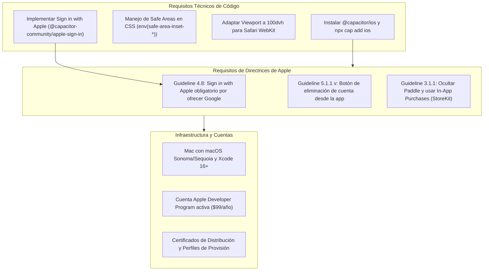

# AUDITORÍA INTEGRAL VIANTRYP — ETAPA 3: SEGURIDAD (OWASP), PWA, CAPACITOR/ANDROID E iOS

**Fecha de Ejecución:** Octubre 2026  
**Entorno Auditado:** Código fuente local (PHP 8.2+, Laravel 12.0, Capacitor 8, Android, Service Worker, Apache/Nginx config)  
**Modalidad:** Solo Lectura (Inspección exhaustiva de vectores de ataque, manifiestos móviles, permisos y directrices de tiendas)

---

## 1. RESUMEN EJECUTIVO DE LA ETAPA 3

En esta etapa se ha realizado una auditoría profunda sobre la seguridad de la aplicación (tomando como estándar OWASP Top 10), el soporte de Progressive Web App (PWA), la configuración nativa de Capacitor/Android en Google Play y el estado de preparación para la futura versión de iOS en Apple App Store.

### Hallazgos Principales:
1. **SSRF y Proxy Abierto sin Throttling en `ImageProxyController`:** El proxy de imágenes intenta bloquear IPs privadas con `FILTER_VALIDATE_IP`, pero es vulnerable a dominios con DNS Rebinding (ej. servicios de metadatos de AWS/GCP `169.254.169.254` o dominios como `nip.io`). Además, no tiene Rate Limiting en `routes/web.php`, exponiendo el servidor a ataques de denegación de servicio y saturación de disco.
2. **Protección de Documentos Frágil (Dependencia Exclusiva de Apache):** En `public/.htaccess` existe una regla `RewriteRule ^storage/documents/.*$ - [F,L]`. Si el entorno de producción utiliza **Nginx** (estándar en Laravel Forge, Ploi o Docker), `.htaccess` es totalmente ignorado y los documentos son servidos públicamente sin autenticación.
3. **Android: Falta de Manejo del Botón Atrás (`backButton`):** Al no implementar el listener de Capacitor para el botón físico/gestual de atrás, la app instalada de Android se cierra o minimiza inesperadamente en lugar de navegar hacia atrás en el historial.
4. **iOS: 4 Bloqueadores Infranqueables para App Store:** La versión iOS carece del paquete `@capacitor/ios`, no tiene implementado *Sign in with Apple* (obligatorio según Apple Guideline 4.8 al ofrecer Google), carece de botón de eliminación de cuenta (Guideline 5.1.1 v) y no soporta compras integradas IAP (Guideline 3.1.1).

---

## 2. AUDITORÍA DE SEGURIDAD PROFUNDA (OWASP TOP 10)

### Matriz de Evaluación OWASP

| Categoría OWASP | Estado en Viantryp | Hallazgo y Diagnóstico Técnico | Severidad |
| :--- | :---: | :--- | :---: |
| **A01: Broken Access Control** | **Vulnerable** | Fuga multi-tenant en `PersonController::all()` (P0) y escalada gratuita en `syncPaddlePlan` (P0). | **P0** |
| **A02: Cryptographic Failures** | **Riesgo Alto** | Almacenamiento de clave privada `voyager_key.pem` y keystore de producción en la raíz del repositorio. Contraseñas de firma en texto plano en `build.gradle`. | **P1** |
| **A03: Injection (SQLi / XSS)** | **Bajo / Seguro** | Uso correcto de consultas parametrizadas Eloquent. En Blade solo existen 2 echos raw controlados. Escapado de comillas en JSON para atributos DOM en `pro-viewer.js`. | **P3** |
| **A04: Insecure Design** | **Vulnerable** | Arquitectura de trial que no degrada cuentas vencidas y cobro sin confirmación por webhook. | **P0** |
| **A05: Security Misconfiguration** | **Riesgo Medio** | Ausencia de cabeceras de seguridad HTTP (`HSTS`, `X-Frame-Options`, `X-Content-Type-Options: nosniff`). Dependencia de `.htaccess` en servidores Nginx. | **P2** |
| **A06: Vulnerable Components** | **Actualizado** | Dependencias al día: Laravel 12.0, Tailwind v4, Capacitor 8.5.2, Vite 7.0. | **P3** |
| **A07: Identification & Auth** | **Riesgo Medio** | Validación DNS en Login (`email:rfc,dns`) puede causar DoS de usuarios legítimos. Sesiones configuradas con `http_only: true` y `same_site: lax`. Falta `SESSION_SECURE_COOKIE=true` forzado. | **P2** |
| **A08: Software & Data Integrity** | **Vulnerable** | Actualización de planes basada en payload no firmado enviado por el navegador del cliente. | **P0** |
| **A09: Logging & Monitoring** | **Implementado** | Laravel Telescope y Horizon instalados. Logs de errores en `storage/logs/laravel.log`. Monitoreo activo. | **P3** |
| **A10: Server-Side Request Forgery** | **Riesgo Alto** | `ImageProxyController::proxy` vulnerable a DNS Rebinding y consumo abusivo de ancho de banda sin Rate Limiting. | **P1** |

---

## 3. AUDITORÍA ESPECÍFICA DE PWA (PROGRESSIVE WEB APP)

### Diagnóstico de Componentes PWA:
- **Manifiesto Web (`public/manifest.json`):**
  - Configurado con `display: "standalone"`, `start_url: "/?app=1"`, `background_color: "#0d2b3e"`, `theme_color: "#0d2b3e"`.
  - Contiene los 8 tamaños de iconos requeridos (desde 72x72 hasta 512x512) y todos existen físicamente en `public/icons/`.
- **Service Worker (`public/sw.js`):**
  - Versión activa: `viantryp-v6`.
  - Estrategia: **Network-First** para peticiones de navegación y estáticos, con fallback a caché.
  - Excluye correctamente rutas `/api/`, `/sanctum/` y `/telescope/`.
- **Deficiencias Identificadas en PWA:**
  1. **Sin pantalla de contingencia offline:** `STATIC_ASSETS` no incluye un `/offline.html`. Si el usuario pierde conexión mientras navega, el navegador muestra la pantalla de error genérica ("Sin conexión a internet").
  2. **Sin persistencia de datos offline (IndexedDB):** Si un viajero abre la PWA en un vuelo o sin cobertura en el extranjero, no puede consultar los itinerarios creados previamente porque dependen exclusivamente de llamadas síncronas a MySQL.

---

## 4. AUDITORÍA ESPECÍFICA DE CAPACITOR Y ANDROID (GOOGLE PLAY)

### Análisis de la Aplicación Publicada:
- **Identificador de Paquete:** `com.viantryp.app`
- **Versión de Producción:** `versionCode 22`, `versionName "1.0.10"`
- **SDKs:** `minSdkVersion 24`, `compileSdkVersion 36`, `targetSdkVersion 36` (Cumple con creces los requisitos de Google Play).
- **Plugins Instalados:** `@capacitor/app`, `@capacitor/splash-screen`, `@capacitor/status-bar`, `@codetrix-studio/capacitor-google-auth`.
- **Arquitectura de Ejecución:** Carga remota de `https://viantryp.com` en WebView.

### Riesgos Críticos en Android:
1. **Cierre Inesperado de la App con Botón Atrás:**
   - No existe implementación de `App.addListener('backButton')`.
   - Cuando un usuario pulsa el botón atrás del sistema o hace el gesto de retroceso, Capacitor no retrocede en el historial del WebView ni cierra modales; **cierra la aplicación de inmediato**.
2. **Exposición de Claves de Producción:**
   - El keystore `viantryp-release-official.keystore` y sus claves en texto plano en `android/app/build.gradle` deben ser retirados del control de versiones para evitar que la identidad de publicación sea comprometida.
3. **Discrepancia en App Links (AssetLinks):**
   - `.well-known/assetlinks.json` en `web.php` declara `com.viantryp.www.twa` en lugar de `com.viantryp.app`, impidiendo que los enlaces de viajes compartidos se abran automáticamente en la app de Android.

---

## 5. EVALUACIÓN DE PREPARACIÓN PARA APPLE APP STORE (iOS)

### Estado Actual: **0% Implementado / No Preparado**

Actualmente **no existe el directorio nativo `/ios` ni la dependencia `@capacitor/ios`**. Para que Viantryp pueda compilarse y publicarse en la tienda de Apple, se deben cumplir los siguientes requisitos:

### Bloqueadores Obligatorios para iOS:
1. **Sign in with Apple (Guideline 4.8):** Dado que Viantryp ofrece inicio de sesión con Google, Apple exige de forma estricta ofrecer *Sign in with Apple* con el mismo nivel de prominencia. Sin esto, el rechazo en revisión es del 100%.
2. **In-App Purchase vs Paddle (Guideline 3.1.1):** No se puede enlazar a Paddle ni abrir checkout web para cobrar suscripciones en la app de iOS. O bien se integra StoreKit (IAP de Apple), o bien se deshabilitan las opciones de compra dentro de la app móvil.
3. **Eliminación de Cuenta (Guideline 5.1.1 v):** Obligatorio permitir al usuario eliminar su cuenta desde los ajustes de la app.

---

## 6. MATRIZ DE RIESGOS ESPECÍFICOS DE LA ETAPA 3

| ID | Severidad | Área | Hallazgo | Solución Recomendada |
| :---: | :---: | :--- | :--- | :--- |
| **SEC-05** | **P1** | **Seguridad / SSRF** | **Proxy de imágenes vulnerable a DNS Rebinding y DoS sin throttling en `ImageProxyController`**. | Validar resolución IP previa al fetch, restringir hosts a dominios de imagen conocidos y aplicar `throttle:60,1`. |
| **SEC-06** | **P1** | **Seguridad Servidor** | **Protección de documentos en `public/.htaccess` ignorada en entornos Nginx**. | Mover adjuntos a `storage/app/private/` para que ningún servidor web los sirva estáticamente. |
| **MOB-01** | **P2** | **Capacitor Android** | **Ausencia de listener para botón atrás de Android cierra la app**. | Implementar `App.addListener('backButton')` para gestionar historial y cierre de modales. |
| **PWA-01** | **P2** | **PWA** | **Ausencia de página offline fallback en `sw.js`**. | Pre-cachear `offline.html` en el evento `install` del Service Worker. |
| **IOS-01** | **P1** | **Preparación iOS** | **Falta de soporte para *Sign in with Apple* y paquete nativo iOS**. | Instalar `@capacitor/ios` e integrar `@capacitor-community/apple-sign-in`. |

